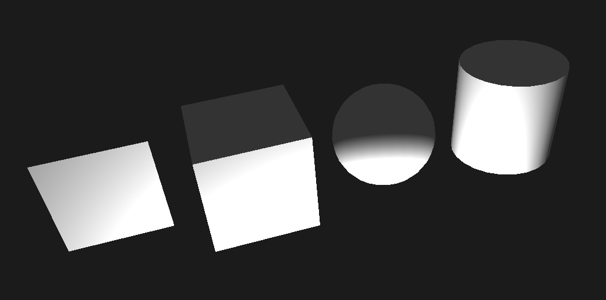

# renderer

A Rust renderer built with `beyv_ecs`, `wgpu`, and an `egui`/`eframe` debug interface.
To run the project, clone the repository and run `cargo run`.

```
Examples Terminal commands:

add_object --name cube --mesh cube --material white_matte --position 0,0,0 --scale 1,1,1
edit_object --object cube --material black_matte --position 2,0,0
animate_object --object cube --transform 0,2,0 --duration 2
add_light --name key_light --color 1,0.9,0.8 --range 10 --intensity 5 --xyz 2,4,1
add_point --name marker --xyz 1,0,0 --size 0.1
add_line --name segment --start 0,0,0 --end 1,2,0 --width 0.025

```


